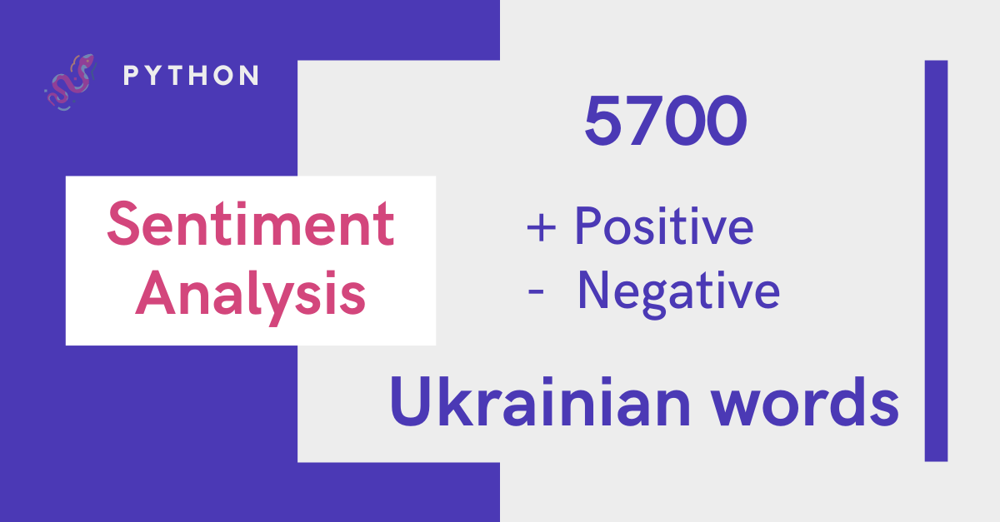

# Ukrainian-Sentiment-Analysis

[](https://github.com/skupriienko/Ukrainian-Sentiment-Analysis/actions/workflows/ci.yml)
[](LICENSE.txt)
[](pyproject.toml)



A curated, categorized Ukrainian sentiment lexicon and zero-dependency Python sentiment analyzer for NLP, opinion mining, and text analytics.

## Key Features (v2.0)

- **Clean & Categorized Source of Truth** (`data/categories/*.txt`): UTF-8 (no BOM), NFC-normalized, lowercase, disjoint source lists cleaned of English machine-translation calques, Latin homoglyphs, Russianisms, stopwords, and contradictory stems.
- **Two Tiers + Phrases + Contextual Modifiers**:
  - **`core` (5,331 unigrams)** — Standard literary/formal Ukrainian positive (`1,744`) and negative (`3,587`) words.
  - **`extended` (5,477 unigrams)** — `core` plus colloquial/social-media expressions (`46` positive, `65` negative) and optional profanity (`35` negative, toggleable via `include_profanity=False`).
  - **`phrases` (179 multi-word expressions)** — Idiomatic positive (`80`) and negative (`99`) multi-word expressions (`без проблем`, `на жаль`, `не рекомендую`, `щиро дякую`, etc.).
  - **`modifiers` (43 contextual words)** — Negations (`18`), intensifiers (`17`), and diminishers (`8`) for rule-based polarity shifting and scaling.
- **Zero-Dependency Rule-Based Analyzer**: `analyze_sentiment()` and `score_text()` support multi-word phrases, negation flipping (`не гарний` -> negative, `не поганий` -> positive), intensifier/diminisher scaling (`дуже гарний`, `трохи сумний`), clause punctuation boundaries, and conservative Ukrainian inflection matching.
- **Apostrophe-Safe by Default**: Automatically supports ASCII `'`, typographic `’`, and modifier `ʼ` apostrophes across lexicons and input text.

---

## Repository Layout

| Path | Description | Format |
| :--- | :--- | :--- |
| `data/categories/*.txt` | Modular source-of-truth lists (sentiment tiers, phrases, modifiers) | UTF-8, sorted |
| `data/sentiment_core.csv` | Standard sentiment unigrams (**5,331** entries) | CSV (`word,score`) |
| `data/sentiment_extended.csv` | Full unigram sentiment lexicon (**5,477** entries) | CSV (`word,score`) |
| `data/phrases_ua.csv` | Multi-word sentiment expressions (**179** phrases) | CSV (`phrase,score`) |
| `data/sentiment_ua.json` | Machine-readable JSON with `counts` and `categories` | JSON (UTF-8) |
| `src/ukrainian_sentiment/` | Zero-dependency Python package (`pip install`) | Python 3.10+ |
| `sentiment_ua.csv` | Backward-compatible semicolon CSV without BOM (**5,656** entries) | CSV (`word;pos_neg`) |

---

## Installation & Quickstart

### Install the Python Package

```bash
pip install "git+https://github.com/skupriienko/Ukrainian-Sentiment-Analysis.git"
```

Or clone locally in editable mode:

```bash
git clone https://github.com/skupriienko/Ukrainian-Sentiment-Analysis.git
cd Ukrainian-Sentiment-Analysis
pip install -e .
```

### Python API

```python
from ukrainian_sentiment import analyze_sentiment, get_lexicon, score_text

result = analyze_sentiment("Це не поганий результат, все пройшло без проблем.")
print(result.label, result.score, result.matches)

# Quick scalar score
print(score_text("Дуже гарна книга, щиро дякую!"))  # positive
print(score_text("На жаль, сервіс жахливий."))     # negative

# Load lexicon dictionary (+1 / -1) without explicit profanity
lexicon = get_lexicon("extended", include_phrases=True, include_profanity=False)
```

### Without Installing (Raw CSV / `pandas`)

```python
import pandas as pd

df = pd.read_csv("sentiment_ua.csv", sep=";")
# Or fetch directly:
# https://raw.githubusercontent.com/skupriienko/Ukrainian-Sentiment-Analysis/main/data/sentiment_core.csv
```

### Integration with `Ukrainian-Stopwords`

When combining with [`Ukrainian-Stopwords`](https://github.com/skupriienko/Ukrainian-Stopwords), keep negations so polarity reversal (`не гарний`, `не поганий`) remains intact:

```python
from ukrainian_stopwords import get_stopwords, remove_stopwords, tokenize_ukrainian
from ukrainian_sentiment import analyze_sentiment

stopwords = get_stopwords("core", keep_negations=True)
tokens = remove_stopwords(tokenize_ukrainian("Це не поганий товар"), stopwords=stopwords)
print(analyze_sentiment(" ".join(tokens)))
```

---

## Lexicon Categories

| Category | Role / Tier | Count | Examples |
| :--- | :--- | ---: | :--- |
| `positive_core` | `+1` (`core`) | 1,744 | `гарний`, `чудовий`, `дякую`, `перемога`, `надійний` |
| `negative_core` | `-1` (`core`) | 3,587 | `поганий`, `жахливий`, `зрада`, `ганьба`, `проблема` |
| `positive_colloquial` | `+1` (`extended`) | 46 | `супер`, `класно`, `крутий`, `топ`, `кайф`, `вау` |
| `negative_colloquial` | `-1` (`extended`) | 65 | `відстій`, `треш`, `крінж`, `лажа`, `халтура` |
| `negative_profanity` | `-1` (`extended`) | 35 | Explicit profanity (filtered when `include_profanity=False`) |
| `phrases_positive` | `+1` (`phrases`) | 80 | `без проблем`, `без помилок`, `щиро дякую`, `чудова робота` |
| `phrases_negative` | `-1` (`phrases`) | 99 | `на жаль`, `не рекомендую`, `марна трата часу`, `з жахом` |
| `negations` | Modifier | 18 | `не`, `ні`, `ані`, `немає`, `без`, `ніколи` |
| `intensifiers` | Modifier | 17 | `дуже`, `надзвичайно`, `абсолютно`, `вкрай`, `цілком` |
| `diminishers` | Modifier | 8 | `трохи`, `трішки`, `дещо`, `майже`, `частково` |

---

## Contributing

All distribution files (`data/*.csv`, `data/sentiment_ua.json`, and root `sentiment_ua.csv`) are generated deterministically from `data/categories/*.txt`.

1. Edit the appropriate file under `data/categories/` (lowercase, UTF-8 without BOM, NFC-normalized, ASCII apostrophe `'`).
2. Regenerate artifacts and run the validation suite:

```bash
pip install -e ".[dev]"
python scripts/build_datasets.py
python scripts/build_datasets.py --check
ruff check .
pyright
pytest -v
```

## License

Released under the [Creative Commons Attribution-ShareAlike 4.0 International License](LICENSE.txt).
